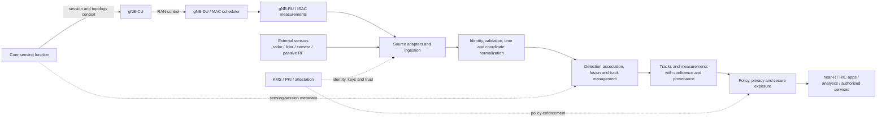

# ISAC Signaling for 5G-Advanced / 6G

Architecture and design research for **Integrated Sensing and Communication (ISAC)** in 5G-Advanced (3GPP Rel-19/20) and emerging 6G systems. The project describes how sensing topologies, radio signaling, and multi-sensor data services can be organized into deployable designs. The component designs are research proposals unless explicitly identified as standardized behavior.

## Key Concepts

- **ISAC** – Communication waveforms and radio resources are reused for object detection, tracking, and target measurement (range, Doppler, angle).
- **Sensing topologies** – Monostatic (same node transmits and receives), bistatic/distributed (different coordinated nodes), and UE-assisted sensing.
- **Signaling stack** – Sensing-session and topology control at L3, resource arbitration at the gNB-DU MAC, and reference-waveform configuration and echo reception at the radio unit (RU).
- **Sensor fusion server** – Ingests ISAC and non-cellular sensor observations, aligns them in time and space, correlates detections into tracks, retains uncertainty, and exposes policy-approved results.
- **DASH** – The proposed Data Access and Security Hub data plane for multi-sensor ingestion, protected processing, and controlled exposure to RIC applications and other authorized consumers.
- **Sensing waveforms** – NR reference signals such as PRS, SRS, and CSI-RS can support controlled sensing, balancing communication capacity with target-estimation quality.
- **Unknown target handling** – Ambiguous or low-confidence returns remain unknown until supported by evidence; confidence and measurement quality accompany the result. It is very important and need more information in terms of design perspective when object is NOT identified or unknown in ISAC system.

## Joint Communication and Sensing on Shared Spectrum

**Recommended proposal: reuse compatible communication transmissions first, then allocate only the additional sensing resources needed to meet an admitted sensing service objective.** A fixed sensing bandwidth percentage or permanently denser pilots is not a joint optimizer. The DU needs a common resource ledger, capability checks, and feedback from both communication and sensing processing.

The design below is an implementation proposal, not a standardized ISAC protocol. Existing NR signals retain their specified purposes and configuration constraints; reusing their echoes for sensing requires validated radio and processing capabilities. New sensing session fields, coordination messages, and reporting APIs require explicitly negotiated implementation-specific interfaces unless a supported standards release defines them.

### 1. Distinguish waveform sharing from signaling overhead

Two different costs must be optimized:

| Cost | What is shared or transmitted | Software implication |
|---|---|---|
| Over-the-air waveform resources | Time, frequency, beam/spatial layers, and transmit power used by data, reference signals, or dedicated sensing bursts | Track PRBs **and symbols**, reference-signal REs, beam/RF-chain occupancy, power, guards, and receive windows; a PRB-only mask is insufficient |
| Control and reporting | Session setup, configuration, activation, distributed-node coordination, and measurement feedback | Track message rate, bytes, retries, deadlines, and configuration versions; distinguish air-interface overhead from fronthaul/backhaul load |

Using the **same carrier** does not imply transmitting communication and sensing independently on the **same resource elements (REs)**. Unified-waveform reuse obtains both functions from one transmitted signal. TDM/FDM share the carrier using separate REs; SDM can overlap time/frequency only when spatial isolation and hardware support are sufficient. None of these makes sensing processing, coordination, or receiver availability free.

### 2. Inputs and feasibility checks before scheduling

| Input owner | Required information | Decision enabled |
|---|---|---|
| Communication scheduler | Per-flow QoS priority, packet-delay budget and head-of-line age, minimum-rate commitments, queue occupancy, CQI/CSI freshness, BLER and HARQ obligations | Protect admitted communication services and estimate actual goodput loss |
| Sensing session manager | Region/geometry, range and velocity resolution, estimation-error limits, detection probability at a specified false-alarm rate, maximum update age, deadline, and priority/preemption policy | Translate an application need into a feasible waveform and observation plan |
| RU/PHY capability registry | Supported bandwidth/numerology, valid reference-signal configurations, beams/RF chains, Tx/Rx concurrency, ADC headroom, measured residual self-interference, switching and processing latency | Reject impossible simultaneous operation and unsupported waveform changes |
| Coordination and fusion services | Tx/Rx node identities, clock/frequency uncertainty, calibration age, transport delay/jitter, track covariance and freshness, interference estimates, compute and transport capacity | Select topology, coordinate observation windows, and avoid spending spectrum on stale or unusable measurements |

For a simple monostatic approximation, range resolution is `delta_R ~= c / (2 * B_eff)` and radial velocity resolution is `delta_v ~= wavelength / (2 * T_CPI)`, where `B_eff` is the useful sensing bandwidth and `T_CPI` the coherent processing interval. These are planning estimates, **not accuracy guarantees**: SNR, clutter, aperture, waveform ambiguity, sampling pattern, synchronization, and geometry also matter. Bistatic measurements require their geometry-specific model.

For example, `1.5 m` nominal range resolution requires about `100 MHz` useful bandwidth under this approximation; dividing a carrier into a narrow sensing sub-band can violate that requirement. Sparse pilots spanning a wide bandwidth need ambiguity/sidelobe validation, not just a bandwidth-span calculation. Check unambiguous range/velocity, coherence, and target motion against the actual sampling pattern; a long integration interval must still fit the update deadline. Report infeasibility or negotiate a reduced service objective rather than silently accepting it.

### 3. Candidate resource-sharing proposals

Evaluate the following candidates against the same communication and sensing requirements, rather than assigning a waveform mode solely by FR1/FR2 band.

| Proposal | When it helps | Required implementation and tradeoff |
|---|---|---|
| **P1: Opportunistic unified-waveform reuse** | Existing DL/UL transmissions illuminate the required region at useful times | Reuse configured CSI-RS, PRS, SRS, or DMRS where suitable; data-aided sensing needs known or reliably reconstructed transmitted symbols. A remote receiver needs authorized access to the necessary reference information. No extra sensing transmission may be needed, but geometry, sample density, and traffic availability can be insufficient |
| **P2: Adaptive reference-signal profiles** | Reuse is almost sufficient but needs additional samples or beam coverage | Preconfigure a small valid profile set and select only through mechanisms supported by the deployed stack. Account for extra pilot REs and lost data capacity. Do not arbitrarily change DMRS density, puncture payloads, or invent DCI/MAC-CE fields |
| **P3: Elastic TDM/FDM reservations** | Reuse cannot meet quality/deadline requirements or simultaneous reception is unsafe | Reserve the smallest feasible time-frequency burst plus guards; reclaim unused reservations and rate-match data only through supported mappings. TDM consumes airtime; FDM reduces sensing bandwidth and may require isolation/guard bands. Neither alone guarantees interference-free operation |
| **P4: Joint beam and power selection / SDM** | Communication beams can illuminate targets, or separate beams provide measured isolation | Score UE/target geometry per candidate beam, RF-chain availability, SINR, leakage, EIRP and total power. Spatial overlap needs calibrated isolation and receiver headroom; more power can improve echoes while harming communication or saturating reception |
| **P5: Coordinated bistatic/distributed sensing** | A separate receiver improves geometry or avoids local Tx leakage | Reserve Tx and Rx resources together, exchange versioned plans ahead of activation, and validate clock/frequency uncertainty. Coherent fusion needs tighter phase calibration than noncoherent fusion. Derive lead time from measured delay/jitter, RU preparation, and margin rather than a fixed slot count |

For monostatic simultaneous Tx/echo reception, require measured antenna isolation and analog/digital cancellation sufficient to prevent receiver saturation and meet echo SINR needs. Digital cancellation cannot recover samples already clipped at the ADC. Otherwise choose a validated separated Tx/Rx burst or bistatic topology. A switched receiver has a blind interval: include switching time and two-way propagation delay in the minimum/maximum observable range calculation.

### 4. Joint scheduler objective and execution

Let candidate `a` define a complete feasible plan: UE grants, sensing jobs, waveform/profile, PRB-symbol map, beams, power, Tx/Rx windows, and coordination/reporting actions. A practical bounded-search proposal is:

```text
score(a) = w_c * U_comm(a) + w_s * U_sense(a)
           - lambda_air * C_air(a)
           - lambda_transport * C_transport(a)
           - lambda_compute * C_compute(a)
           - lambda_switch * C_reconfiguration(a)
```

`U_comm` is normalized predicted delivered goodput with fairness and packet urgency; `U_sense` is normalized, job-specific expected information gain or reduction in estimation uncertainty, with deadline urgency. Every utility and cost must depend on the candidate and share documented normalization/scaling. For example, a beam covering a target may reduce its predicted covariance while another beam does not. **Adding the same sensing constant to every UE score does not change allocation.** A Cramér-Rao bound can support planning under a validated model but is not measured accuracy or evidence of target detection.

Filter candidates by hard constraints **before** scoring: admitted communication delay/reliability and minimum service, protected control/reference resources and HARQ timing, admitted sensing deadlines/quality, TDD direction, legal NR mappings, power/interference limits, hardware/calibration/synchronization validity, and compute/transport deadlines. Predicted feasibility must be checked against observed performance; no score guarantees a radio SLA under all channel conditions.

```text
On session admission or slow policy update:
    validate capabilities, geometry, budgets, and allowed degradation
    build a bounded catalog of feasible profiles and resource templates
    accept with explicit service bounds, or reject with a reason

Before each scheduling deadline:
    read a versioned snapshot of queues, tracks, channel and radio health
    reserve protected communication resources and existing commitments
    evaluate useful reuse of already planned transmissions
    form bounded candidates for any remaining sensing quality/deadline gap
    reject candidates violating hard constraints; score the remainder
    commit a conflict-free plan with acknowledged participants before cutoff
    if no joint plan is feasible, retain protected communication service
        and explicitly defer/degrade/reject sensing per admission policy
    dispatch supported UE grants and separate PHY/coordination commands

After execution:
    correlate measurements to the plan; update quality, age, and cost models
    emit deadline/quality violations and failure reasons; release resources
```

Safety-critical sensing must have an explicit admission, reserved-capacity, and preemption contract; it must not be silently treated as best-effort or allowed to override communication protections through an unbounded weight. Use measured execution time to bound catalog size and real-time work. Run expensive optimization outside the slot loop; apply versioned snapshots, validity windows, and hysteresis/minimum dwell time to avoid stale decisions and profile oscillation.

### 5. Reduce control and measurement signaling

| Proposal | Mechanism | Required safeguard |
|---|---|---|
| Configure once, reference often | Install reusable waveform/beam/report profiles; activation references `profile_id`, version, and effective radio time instead of resending full configuration | Confirm installation before activation; expire stale profiles and reject version mismatch |
| Batch and delta updates | Group compatible jobs and send only changed fields; use persistent reservations for periodic sensing and return unused capacity | Include a base version, bounded batch delay, validity interval, and explicit release; resynchronize after lost state |
| Event-triggered reporting | Send compact detections/tracks and covariance when innovation, quality, or age thresholds are crossed; keep periodic health/heartbeat reports | Bound maximum report age and report missed detections/degradation; silence must not mean “no target” |
| Local preprocessing | Estimate/filter near the RU/DU; forward policy-approved measurements instead of continuous raw IQ | Preserve timestamps, calibration, uncertainty and provenance; use bounded, authorized diagnostic IQ capture when needed |
| Advance multi-node coordination | Reserve a shared plan and obtain receiver readiness before the commit cutoff; use idempotent updates | Bound retries, cancel/expire incomplete reservations, reject late commands, and distinguish plan acceptance from actual execution |

Air-interface configuration and grants must use mechanisms supported by the UE and network. Internal DU-RU control is not automatically a UE MAC-CE. Do not presume generic sensing payloads or new information elements are available over F1/Xn; specify the deployed interface, schema, transport, timing, authentication, and authorization. Signaling reduction must not remove acknowledgments or health feedback required to detect failure.

### 6. Proposed software contract and failure behavior

These are **logical internal/API fields**, not standardized wire information elements:

| Contract | Minimum fields |
|---|---|
| `SensingJob` | Session/job ID, authorized region, topology and participants, quality targets with units, deadline/max age, priority, allowed degradation/preemption, policy reference |
| `ResourcePlan` | Plan ID/version, profile ID/version, carrier/BWP/numerology, absolute radio-time epoch and slot/symbol intervals, PRB/RE mapping, beams/power, Tx/Rx/guard windows, participant readiness, commit cutoff, expiry |
| `ExecutionReport` | Plan/job IDs, actual capture time and resource usage, executed/partial/failed status, measured quality/covariance and calibration/sync validity, reason codes |
| `MeasurementReport` | Plan/job IDs, event time and report time, coordinate frame, detection/track state and uncertainty, confidence/class including unknown, provenance, freshness and failure/no-detection distinction |

Use an explicit lifecycle such as `REQUESTED -> ADMITTED -> PREPARED -> COMMITTED -> EXECUTED -> REPORTED`, with `REJECTED`, `EXPIRED`, `CANCELLED`, and `FAILED` exits. Make retries idempotent, reserve participant resources only until a bounded expiry, and propagate cancellation. Do not activate distributed plans with missing readiness acknowledgments; post-commit link/hardware failures still need execution reports and timeout handling. Track freshness advances only on a valid observation, never merely on a scheduled grant.

On stale CSI, lost synchronization, excessive leakage, expired calibration, RU failure, or reporting/compute overload, stop the affected unsafe sensing mode, release/cancel its reservations, retain protected communication service, and notify the session owner with a reason and retry/degradation decision. Preserve unknown targets and uncertainty; a low class-confidence score alone must not trigger unlimited extra sensing allocations.

### 7. Worked resource budget and evaluation plan

**Illustrative accounting only:** consider `100 PRBs x 14 symbols x 20 slots = 28,000 PRB-symbols` in a `10 ms` window at `30 kHz` SCS with normal cyclic prefix. Existing control/reference allocations are part of this grid; only an eligible subset is schedulable. A baseline reserves two full slots for sensing, costing `2,800 PRB-symbols` (10% of the gross grid), in addition to pre-existing overhead.

Suppose validated reuse supplies most required observations, and one additional full-band `2-symbol` burst plus `1 full-band guard symbol` closes the gap. Incremental cost is then `100 x 3 = 300 PRB-symbols` (about 1.07%), releasing `2,500 PRB-symbols` relative to the baseline. This is feasible **only if** the actual bandwidth, repetition/coherent observation pattern, receive timing, and measured sensing quality meet the same objectives. It is not a guaranteed throughput gain: count any extra pilots/control, retransmissions, power/beam contention, and transport/compute costs separately. Count a reused RE once in physical occupancy while tagging it as benefiting both functions.

Evaluate communication-only, fixed-reservation, reuse-only, and adaptive-joint policies on identical traffic, channels, target trajectories, and hardware assumptions. Sweep offered load, target speed/count, clutter, sync error, and transport jitter; include no-data periods, urgent communication, unknown targets, lost/late/duplicate commands, stale profiles, receiver saturation, and missing reports.

| Dimension | Metrics and acceptance rule |
|---|---|
| Communication | Goodput and per-flow tail latency, deadline misses, BLER/HARQ load, minimum-rate compliance and fairness; satisfy the admitted per-service bounds |
| Sensing | Detection probability at the agreed false-alarm rate, range/velocity/angle error distribution, track continuity and maximum observation age; satisfy the same targets used for the baseline |
| Overhead | Incremental occupied RE/PRB-symbols including guards/pilots/control, messages and bytes per interface, retries, raw-IQ/measurement traffic, energy per valid update |
| Software operation | Worst-case scheduler time against the configured dispatch deadline, CPU/GPU/memory, queue age, rejected/infeasible jobs, cancellation/expiry cleanup, stale-plan and collision count |

Set numeric service thresholds before evaluation; plot the communication/sensing tradeoff rather than claiming both always improve. Accept an optimization only when overhead decreases **and** both admitted service bounds remain satisfied, with execution/failure evidence. See the [MAC scheduler design](docs/design/components/isac_mac_scheduler_design.md) for illustrative integration sketches and the [DASH specification](docs/design/components/dash_design_specification.md) for measurement transport and policy.

## Sensor Fusion Server: Logical Architecture

The fusion server is a data-plane service, distinct from the sensing function (SF) that controls sensing sessions. It can be a standalone edge service or be deployed as DASH components across baseband, DU, and higher-layer infrastructure. The diagram shows logical functions; it does not prescribe a standardized 3GPP interface between every block.



### Processing responsibilities

1. **Ingest and validate:** adapters accept timestamped observations from ISAC processing and registered external sensors; validate source identity, schema, signature/provenance, and basic sensor health.
2. **Normalize:** map sensor-specific fields into a common observation model and transform coordinates into a declared reference frame. Preserve source timestamps and quality indicators; account for clock offset, calibration, and late or out-of-order reports.
3. **Associate and fuse:** correlate detections across sensors and time, maintain tracks, and record which observations support each estimate. Fusion may be centralized at the edge or split between local pre-processing and a higher-layer service.
4. **Publish controlled data products:** expose tracks or aggregate measurements with event time, source/provenance, confidence, uncertainty/quality, and freshness. Keep raw IQ or sensitive imagery local by default; release only when an explicit policy permits it.
5. **Protect and operate:** authenticate producers and consumers, enforce least-privilege subscriptions, audit decisions, monitor queue depth and data age, and use bounded backpressure so stale observations do not silently appear current. If evidence is insufficient, publish an unknown/low-confidence result rather than forcing a class label.

## 5G-Advanced Perspective

For a 5G-A deployment, treat the fusion server as an **operator-controlled edge or near-RT RIC-adjacent application**, not as a new standardized gNB node. The SF and CU coordinate the sensing session and participating topology; the DU scheduler and RU handle radio-resource and waveform operations. The server receives resulting measurements through implementation-specific adapters or service integrations, combines them with external sensor observations, and provides approved tracks to RIC applications or other consumers.

Keep the control and data paths distinct: F1/Xn and RAN signaling coordinate radio operation as supported by the deployment, while sensor payload delivery and fusion use explicitly defined data-plane interfaces. Do not assume that F1 or Xn carries arbitrary camera, lidar, or fused-track payloads. This approach lets operators add fusion without changing the radio node roles, while leaving interface details and deployment latency to the implementation.

## 6G Perspective

For a 6G-oriented design, DASH is the proposed **secure multi-sensor data-plane foundation** for the fusion service. Its logical functions can be placed across baseband hardware, DU edge, and higher-layer edge/cloud: low-latency parsing and preprocessing near the radio, local policy enforcement at the DU, and broader cross-cell fusion and analytics at higher layers. The exact placement depends on latency, compute, and privacy needs.

The 6G design extends the 5G-A service with sensor identity and attestation, zero-trust access, policy-aware subscriptions, privacy-preserving processing, and trust/provenance metadata on exposed data. gRPC/Protobuf is the proposed service contract in the DASH specification; RIC adapters and cross-domain APIs remain integration choices to validate. These are architectural proposals, not claims that the functions or interfaces are already standardized for 6G.

| Concern | 5G-Advanced deployment view | 6G design view |
|---|---|---|
| **Fusion role** | Edge application consumes sensing measurements and external sensor feeds | DASH-backed data-plane capability supports multi-sensor fusion and trusted data products |
| **Placement** | Operator edge or near-RT RIC-adjacent server | Composable across baseband, DU edge, and higher-layer edge/cloud |
| **RAN relationship** | SF/CU coordinate sessions; DU/RU perform radio sensing functions | Same radio responsibilities, with richer distributed data processing and policy integration |
| **Exposure** | Operator-defined adapters and application interfaces | Proposed gRPC/Protobuf subscriptions with policy and trust metadata |
| **Security focus** | Operator authentication, authorization, and data handling controls | Zero-trust identity, attestation, protected processing, and privacy-aware exposure |
| **Standardization status** | Integrate with available 5G-A capabilities; fusion API is implementation-specific | Research architecture; DASH capabilities and interfaces require validation and standardization work |

## Repository Layout

```
.
├── .gitignore
├── LICENSE
├── README.md
├── docs/
│   ├── ARCHITECTURE.md                      # Architecture overview and reading guide
│   ├── architecture/
│   │   └── 5G-A_ISAC_Highlevel.md           # ISAC signaling flow and parameter specification
│   ├── assets/                              # Diagrams and media assets
│   └── design/
│       ├── DESIGN_INDEX.md                  # Component design index
│       └── components/
│           ├── dash_design_specification.md # DASH data plane and security design
│           └── isac_mac_scheduler_design.md # ISAC-aware gNB MAC scheduler
└── research/
    ├── PAPERS_INDEX.md                      # Reference papers by topic
    └── papers/                              # Research PDFs
```

## Navigation Guide

| If you want to… | Start here |
|---|---|
| Understand the overall system and sensing waveforms | [docs/ARCHITECTURE.md](docs/ARCHITECTURE.md) |
| Design shared-spectrum allocation and reduce signaling overhead | [Joint communication and sensing proposals](#joint-communication-and-sensing-on-shared-spectrum) |
| Read the signaling flow and parameters (L3/L2/L1) | [docs/architecture/5G-A_ISAC_Highlevel.md](docs/architecture/5G-A_ISAC_Highlevel.md) |
| Browse component designs | [docs/design/DESIGN_INDEX.md](docs/design/DESIGN_INDEX.md) |
| Study the sensing data plane, fusion, and security | [DASH specification](docs/design/components/dash_design_specification.md) |
| Study scheduler integration | [MAC scheduler design](docs/design/components/isac_mac_scheduler_design.md) |
| Find the supporting literature | [research/PAPERS_INDEX.md](research/PAPERS_INDEX.md) |

## Status

Working research notes. 5G-A signaling descriptions and proposed 6G/DASH designs are documented separately; evolving standards work and implementation validation may change details.

## License

See [LICENSE](LICENSE).
