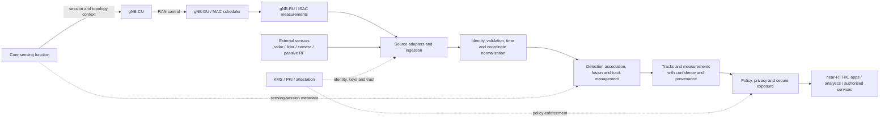

# ISAC Signaling for 5G-Advanced / 6G

Architecture and design research for **Integrated Sensing and Communication (ISAC)** in 5G-Advanced (3GPP Rel-19/20) and emerging 6G systems. The project describes how sensing topologies, radio signaling, and multi-sensor data services can be organized into deployable designs. The component designs are research proposals unless explicitly identified as standardized behavior.

## Key Concepts

- **ISAC** – Communication waveforms and radio resources are reused for object detection, tracking, and target measurement (range, Doppler, angle).
- **Sensing topologies** – Monostatic (same node transmits and receives), bistatic/distributed (different coordinated nodes), and UE-assisted sensing.
- **Signaling stack** – Sensing-session and topology control at L3, resource arbitration at the gNB-DU MAC, and reference-waveform configuration and echo reception at the radio unit (RU).
- **Sensor fusion server** – Ingests ISAC and non-cellular sensor observations, aligns them in time and space, correlates detections into tracks, retains uncertainty, and exposes policy-approved results.
- **DASH** – The proposed Data Access and Security Hub data plane for multi-sensor ingestion, protected processing, and controlled exposure to RIC applications and other authorized consumers.
- **Sensing waveforms** – NR reference signals such as PRS, SRS, and CSI-RS can support controlled sensing, balancing communication capacity with target-estimation quality.
- **Unknown target handling** – Ambiguous or low-confidence returns remain unknown until supported by evidence; confidence and measurement quality accompany the result. It is very important and need more information in terms of design perspective when object is NOT identified or unknown in ISAC system.

## Sensor Fusion Server: Logical Architecture

The fusion server is a data-plane service, distinct from the sensing function (SF) that controls sensing sessions. It can be a standalone edge service or be deployed as DASH components across baseband, DU, and higher-layer infrastructure. The diagram shows logical functions; it does not prescribe a standardized 3GPP interface between every block.



### Processing responsibilities

1. **Ingest and validate:** adapters accept timestamped observations from ISAC processing and registered external sensors; validate source identity, schema, signature/provenance, and basic sensor health.
2. **Normalize:** map sensor-specific fields into a common observation model and transform coordinates into a declared reference frame. Preserve source timestamps and quality indicators; account for clock offset, calibration, and late or out-of-order reports.
3. **Associate and fuse:** correlate detections across sensors and time, maintain tracks, and record which observations support each estimate. Fusion may be centralized at the edge or split between local pre-processing and a higher-layer service.
4. **Publish controlled data products:** expose tracks or aggregate measurements with event time, source/provenance, confidence, uncertainty/quality, and freshness. Keep raw IQ or sensitive imagery local by default; release only when an explicit policy permits it.
5. **Protect and operate:** authenticate producers and consumers, enforce least-privilege subscriptions, audit decisions, monitor queue depth and data age, and use bounded backpressure so stale observations do not silently appear current. If evidence is insufficient, publish an unknown/low-confidence result rather than forcing a class label.

## 5G-Advanced Perspective

For a 5G-A deployment, treat the fusion server as an **operator-controlled edge or near-RT RIC-adjacent application**, not as a new standardized gNB node. The SF and CU coordinate the sensing session and participating topology; the DU scheduler and RU handle radio-resource and waveform operations. The server receives resulting measurements through implementation-specific adapters or service integrations, combines them with external sensor observations, and provides approved tracks to RIC applications or other consumers.

Keep the control and data paths distinct: F1/Xn and RAN signaling coordinate radio operation as supported by the deployment, while sensor payload delivery and fusion use explicitly defined data-plane interfaces. Do not assume that F1 or Xn carries arbitrary camera, lidar, or fused-track payloads. This approach lets operators add fusion without changing the radio node roles, while leaving interface details and deployment latency to the implementation.

## 6G Perspective

For a 6G-oriented design, DASH is the proposed **secure multi-sensor data-plane foundation** for the fusion service. Its logical functions can be placed across baseband hardware, DU edge, and higher-layer edge/cloud: low-latency parsing and preprocessing near the radio, local policy enforcement at the DU, and broader cross-cell fusion and analytics at higher layers. The exact placement depends on latency, compute, and privacy needs.

The 6G design extends the 5G-A service with sensor identity and attestation, zero-trust access, policy-aware subscriptions, privacy-preserving processing, and trust/provenance metadata on exposed data. gRPC/Protobuf is the proposed service contract in the DASH specification; RIC adapters and cross-domain APIs remain integration choices to validate. These are architectural proposals, not claims that the functions or interfaces are already standardized for 6G.

| Concern | 5G-Advanced deployment view | 6G design view |
|---|---|---|
| **Fusion role** | Edge application consumes sensing measurements and external sensor feeds | DASH-backed data-plane capability supports multi-sensor fusion and trusted data products |
| **Placement** | Operator edge or near-RT RIC-adjacent server | Composable across baseband, DU edge, and higher-layer edge/cloud |
| **RAN relationship** | SF/CU coordinate sessions; DU/RU perform radio sensing functions | Same radio responsibilities, with richer distributed data processing and policy integration |
| **Exposure** | Operator-defined adapters and application interfaces | Proposed gRPC/Protobuf subscriptions with policy and trust metadata |
| **Security focus** | Operator authentication, authorization, and data handling controls | Zero-trust identity, attestation, protected processing, and privacy-aware exposure |
| **Standardization status** | Integrate with available 5G-A capabilities; fusion API is implementation-specific | Research architecture; DASH capabilities and interfaces require validation and standardization work |

## Repository Layout

```
.
├── .gitignore
├── LICENSE
├── README.md
├── docs/
│   ├── ARCHITECTURE.md                      # Architecture overview and reading guide
│   ├── architecture/
│   │   └── 5G-A_ISAC_Highlevel.md           # ISAC signaling flow and parameter specification
│   ├── assets/                              # Diagrams and media assets
│   └── design/
│       ├── DESIGN_INDEX.md                  # Component design index
│       └── components/
│           ├── dash_design_specification.md # DASH data plane and security design
│           └── isac_mac_scheduler_design.md # ISAC-aware gNB MAC scheduler
└── research/
    ├── PAPERS_INDEX.md                      # Reference papers by topic
    └── papers/                              # Research PDFs
```

## Navigation Guide

| If you want to… | Start here |
|---|---|
| Understand the overall system and sensing waveforms | [docs/ARCHITECTURE.md](docs/ARCHITECTURE.md) |
| Read the signaling flow and parameters (L3/L2/L1) | [docs/architecture/5G-A_ISAC_Highlevel.md](docs/architecture/5G-A_ISAC_Highlevel.md) |
| Browse component designs | [docs/design/DESIGN_INDEX.md](docs/design/DESIGN_INDEX.md) |
| Study the sensing data plane, fusion, and security | [DASH specification](docs/design/components/dash_design_specification.md) |
| Study scheduler integration | [MAC scheduler design](docs/design/components/isac_mac_scheduler_design.md) |
| Find the supporting literature | [research/PAPERS_INDEX.md](research/PAPERS_INDEX.md) |

## Status

Working research notes. 5G-A signaling descriptions and proposed 6G/DASH designs are documented separately; evolving standards work and implementation validation may change details.

## License

See [LICENSE](LICENSE).
