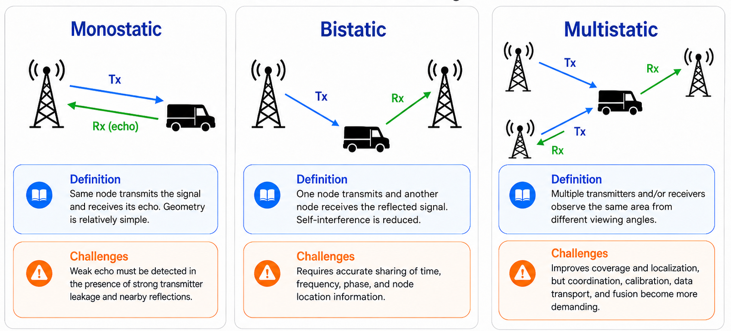

# ISAC Architecture Guide

This guide gives an end-to-end view of the ISAC architecture and points to the detailed specifications.

The [5G-A ISAC signaling specification](architecture/5G-A_ISAC_Highlevel.md) provides detailed protocol flow and parameter context.

## Concepts and measurements

The [ISAC basics illustration](assets/reference/6G_Research_ISAC_Basics_01.jpeg) introduces the shared communication-and-sensing purpose and processing flow. The [measurement types illustration](assets/reference/6G_Research_ISAC_MeasType_01.jpeg) is a quick reference for metrics used to describe sensing results.

## 1. System View

```
[ Core Network / Sensing Function (SF) ]  <-- sensing session, fusion server
                  │  L3 (SBI, e.g. TS 29.545)
            ┌─────▼─────┐
            │  gNB-CU   │  session control, topology assignment
            └─────┬─────┘
                  │  F1AP – Sensing Resource Coordination IE
            ┌─────▼─────┐        ┌────────────────────────┐
            │  gNB-DU   │◄──────►│ DASH (sensing data     │
            │ MAC sched │        │ plane, secure exposure)│
            └─────┬─────┘        └────────────────────────┘
                  │  MAC-CE activation
            ┌─────▼─────┐
            │  gNB-RU   │  L1: PRS/SRS/CSI-RS based sensing, echo Rx
            └───────────┘
```

## Modes and topology



Use this diagram when reviewing sensing-node arrangements and operating modes alongside the topology and signaling details in the [5G-A ISAC signaling specification](architecture/5G-A_ISAC_Highlevel.md).

## 2. Layered Responsibilities

| Layer | Node | Responsibility | Detail |
|---|---|---|---|
| L3 | Core/SF, CU | Sensing session initiation, geofencing, multi-node topology | [Highlevel §1](architecture/5G-A_ISAC_Highlevel.md) |
| L2 | DU | Sensing/communication resource arbitration, MAC-CE, scheduling | [Highlevel §2–3](architecture/5G-A_ISAC_Highlevel.md), [MAC scheduler](design/components/isac_mac_scheduler_design.md) |
| L1 | RU | Reference waveform configuration, echo reception | [Highlevel §4](architecture/5G-A_ISAC_Highlevel.md) |
| Data plane | RAN / near-RT RIC | Multi-sensor aggregation, privacy, exposure | [DASH](design/components/dash_design_specification.md) |

## 2.1 Sensing Waveforms in ISAC

In ISAC, the sensing waveform is not an entirely separate radar waveform family. Rather, it is usually a disciplined reuse of NR reference and data-bearing signal structure so that the network can transmit a known pattern, observe the reflected echo, and then estimate target range, speed, and angle.

The most important waveform families for sensing are:

- PRS (Positioning Reference Signal): the most direct downlink sensing reference for monostatic or network-assisted measurements.
- SRS (Sounding Reference Signal): useful for uplink or UE-assisted sensing when the UE or network acts as a transmitter/receiver pair.
- CSI-RS (Channel State Information Reference Signal): used when beam management and channel estimation are already available, making it attractive for angle and beam-sensitive sensing.
- DMRS / data-bearing OFDM symbols: sometimes reused opportunistically, but these are usually less clean for sensing because communication payloads are not optimized for radar-like parameter estimation.

The waveform design revolves around four dominant variables:

- bandwidth: controls range resolution,
- repetition period / PRI: controls ambiguity and Doppler capability,
- comb density and resource allocation: controls sensing duty cycle vs. communication capacity,
- beamforming / spatial pattern: improves target separation and detection gain.

This is why L1 ISAC design is fundamentally about scheduling a known transmit pattern and then processing the reflected return, not simply about creating a bespoke radar signal from scratch.

## 2.2 Unknown Target Handling in Sensing Analysis

A critical ISAC problem is that not every detected return maps cleanly to a known object class. Many sensing reports are ambiguous, low-confidence, or simply “unknown”. The analysis pipeline should therefore treat unknown targets as first-class outputs instead of forcing premature classification.

Recommended handling:

- Uncertainty-aware labeling: every object report should include confidence, SNR, clutter score, and measurement quality. If the score is poor, mark the object as “unknown / low confidence” instead of assigning a class.
- Anomaly scoring: compute how far the observed signature is from the known class distributions. Large deviations can indicate novel objects, clutter, or mis-association.
- Fallback classification: if a target cannot be confidently tied to a known class, assign a generic label such as “unidentified moving object,” “unknown reflector,” or “likely clutter,” while retaining the raw measurement.
- Track continuity checks: an object may be unknown for a few sensing frames but still correspond to a real track. Use motion continuity, Doppler consistency, and persistence over time before labeling it as a false alarm.
- Cross-sensor corroboration: if radar, camera, lidar, or communication-side measurements disagree, use sensor fusion to decide whether the object is genuinely unknown, clutter, or a known target with poor signal quality.
- Clutter and false alarm filtering: unknown objects should be separated from expected environmental clutter, especially near vegetation, buildings, or atmospheric artifacts.
- No overconfident labeling: if the object signature is too noisy, sparse, or novel, avoid “drone,” “vehicle,” or “bird” labels unless there is enough evidence. The safer default is “unidentified object with low confidence.”
- Confidence-driven reporting: when the system reports “unknown,” it should still retain the target state vector, confidence level, and reason for ambiguity so downstream apps can decide whether to escalate, inspect, or ignore it.

A simple logic pattern is:

```text
if confidence < threshold
    => label as UNKNOWN / LOW CONFIDENCE
elif signature matches known class with enough evidence
    => assign class
else
    => keep as UNKNOWN and continue track association

```

## 3. Deployment Topologies

- **Monostatic** – one gNB transmits and receives; handled by the local sensing manager in the MAC scheduler.
- **Bistatic / distributed** – Tx and Rx on different nodes; requires Xn extensions and guard windows.
- **UE-assisted** – UE contributes measurements or acts as Tx/Rx.

## 4. Standards Context

3GPP Rel-19 (sensing study, TR 22.837), Rel-20 enhancements, ITU-R IMT-2030 (M.2160), IEEE 802.11bf, ETSI ISG ISAC. See [Highlevel](architecture/5G-A_ISAC_Highlevel.md) and the [paper index](../research/PAPERS_INDEX.md).

## 5. Suggested Reading Order

1. [5G-A_ISAC_Highlevel.md](architecture/5G-A_ISAC_Highlevel.md) – signaling flow and parameters
2. [Design index](design/DESIGN_INDEX.md) – component designs
3. [Paper index](../research/PAPERS_INDEX.md) – supporting research
4. [Waveform and unknown-target guidance](docs/ARCHITECTURE.md) – sensing waveform reuse and analysis handling

For the signal-processing view, see the [design index](design/DESIGN_INDEX.md). The complete visual inventory is in the [assets index](assets/ASSETS_INDEX.md).
