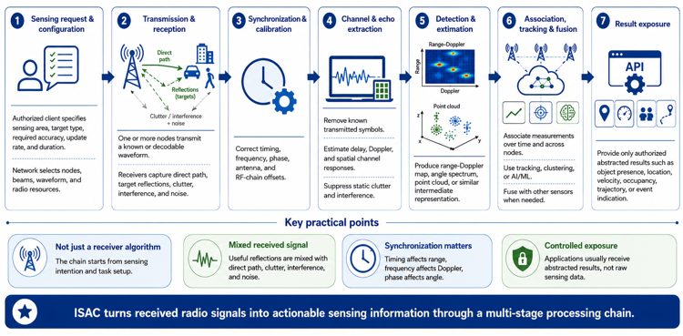

# Design Documentation Index

Component-level designs that realize the [ISAC architecture](../ARCHITECTURE.md).

## Signal processing

The diagram provides a high-level view of processing sensing signals and echoes into measurements and target estimates. For protocol-layer processing, scheduling, and reporting details, see the [5G-A ISAC signaling specification](../architecture/5G-A_ISAC_Highlevel.md) and [MAC scheduler design](components/isac_mac_scheduler_design.md).

| Component | Document | Layer / Scope | Summary |
|---|---|---|---|
| ISAC MAC Scheduler | [isac_mac_scheduler_design.md](components/isac_mac_scheduler_design.md) | L2, gNB-DU | Modifies a native 3GPP gNB MAC scheduler for ISAC: monostatic/bistatic modes, dual-waveform (unified MIMO-OFDM vs. split radar/cellular), scheduling loop, C/C++ data structures, Lyapunov weight engine, sub-ms timing, DCI reference design. |
| DASH | [dash_design_specification.md](components/dash_design_specification.md) | 6G RAN data plane | Data Access and Security Hub: multi-sensor aggregation, zero-trust access, Protobuf/gRPC APIs, TEE/HE/differential privacy, attestation. |

## Related

- Signaling and parameters: [5G-A_ISAC_Highlevel.md](../architecture/5G-A_ISAC_Highlevel.md)
- Literature: [PAPERS_INDEX.md](../../research/PAPERS_INDEX.md)

For architectural context and other diagrams, see the [architecture overview](../ARCHITECTURE.md) and [visual assets index](../assets/ASSETS_INDEX.md).
