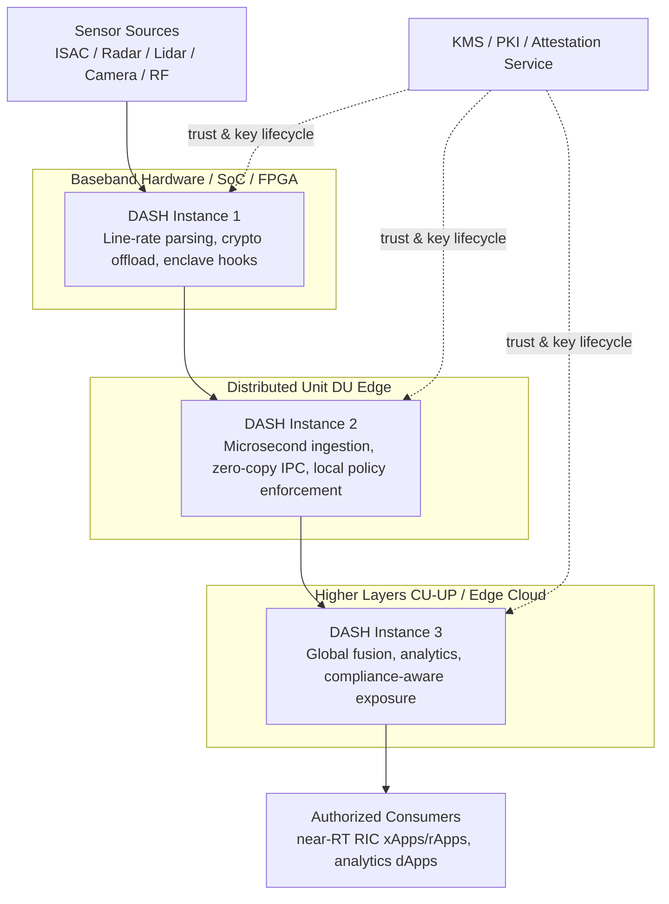
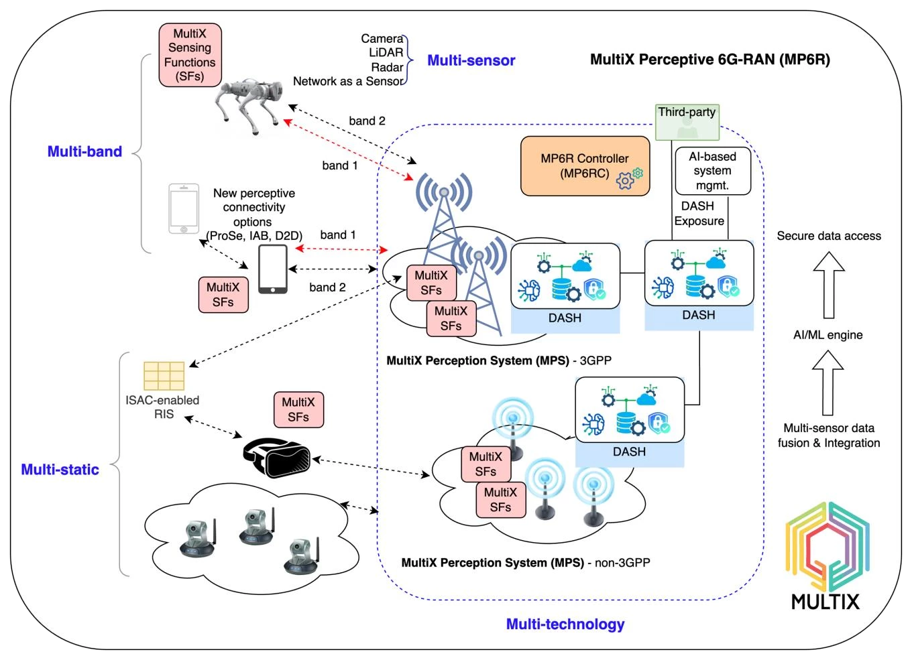
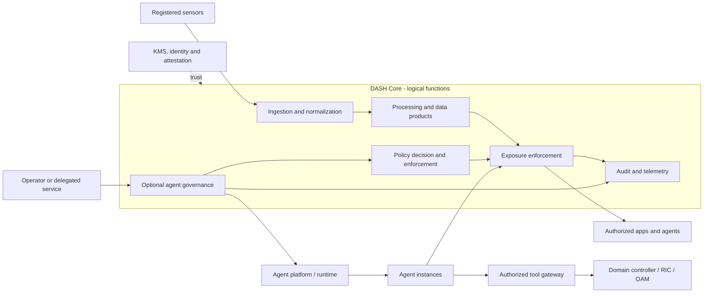
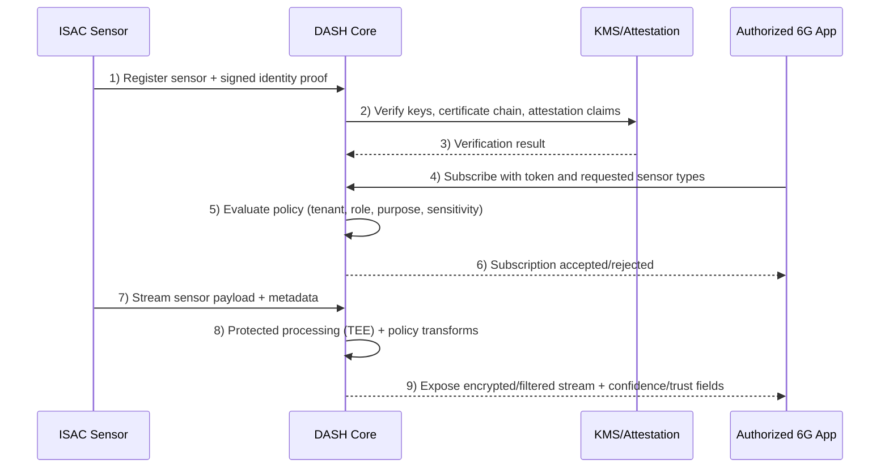

# Data Access and Security Hub (DASH): Technical Design Specification

## 1. Executive Summary

The **Data Access and Security Hub (DASH)** is a proposed 6G RAN data-plane capability that provides:

- **Multi-sensor data aggregation** (ISAC, radar, lidar, camera, RF fingerprinting, and other telemetry)
- **Policy-driven secure data access** for authorized xApps/rApps/dApps
- **Privacy-preserving processing** using TEEs and selective homomorphic techniques
- **Ultra-low-latency exposure paths** for near-real-time RAN intelligence loops

DASH is designed to support **cross-domain innovation goals** aligned with broader 6G initiatives such as multi-technology experimentation, AI-native automation, and trustworthy data sharing across heterogeneous infrastructures.

The **DASH Core** is the logical set of services that coordinates these capabilities and enforces their access boundaries. Section 4.2 defines its role, accessibility, and a proposed, optional mechanism for governing AI-agent operations. This is a research design, not a claim that DASH, its APIs, or agent controls are implemented or standardized.

---

## 2. Design Goals and Non-Goals

### 2.1 Goals

1. **Deterministic, low-latency ingestion and exposure** for time-sensitive RAN sensing/control loops.
2. **Zero-trust security posture** at the data plane boundary.
3. **Deployment flexibility** across hardware, DU edge, and cloud/higher layers.
4. **Interoperable interfaces** via gRPC/Protobuf and policy-based service contracts.
5. **Auditable trust signals** (attestation, lineage, confidence/trust metrics).

### 2.2 Non-Goals

- DASH is **not** a replacement for full OAM/OSS data lakes.
- DASH is **not** a generic long-term archival platform.
- DASH does **not** expose raw sensitive payloads by default; exposure is policy-gated.
- DASH Core is **not** the sensing-session controller, RAN scheduler, or an unrestricted AI-agent runtime. Agent control, if deployed, is mediated through authorized platform and domain-controller interfaces.

---

## 3. System Context and Placement in 6G Architecture

DASH can be instantiated at multiple tiers depending on latency budget, compute capacity, and security/performance requirements.

### 3.1 Corrected Cross-Layer Deployment Diagram (Mermaid)



### 3.2 MultiX Perceptive 6G-RAN Ecosystem Diagram



*Figure: MultiX Perceptive 6G-RAN (MP6R) ecosystem and the role of DASH in sensor-data integration and secure exposure.*

The figure places DASH in a broader **multi-band, multi-static, multi-sensor, and multi-technology** perception environment. It complements the deployment view in Section 3.1: that view describes where DASH can run, while this diagram shows the kinds of sensing systems and consumers that exchange data through the DASH capability.

- **Multi-band sensing and connectivity:** Camera, LiDAR, radar, and network-as-a-sensor inputs appear alongside MultiX Sensing Functions (SFs). The arrows labeled *band 1* and *band 2* illustrate that sensing and perceptive connectivity can span multiple bands. The user/device side also calls out ProSe, IAB, and D2D as perceptive connectivity options.
- **Multi-static and heterogeneous sources:** The lower-left portion includes an ISAC-enabled reconfigurable intelligent surface (RIS), wearable/device imagery, and distributed sensing endpoints. These illustrate that observations can come from spatially separated sources rather than one collocated sensor. MultiX SFs provide the sensing functions associated with these endpoints.
- **3GPP and non-3GPP perception systems:** The dashed MP6R system boundary contains both a 3GPP MultiX Perception System (MPS) and a non-3GPP MPS. The multiple DASH blocks indicate data-service placement across this heterogeneous environment; they should be read as a system-level view, not as a requirement for a fixed number of DASH instances.
- **DASH integration and exposure:** DASH is positioned between MultiX sensing/perception functions and the consumers of their data. In this specification, that role maps to sensor registration, ingestion and normalization, policy enforcement, privacy-preserving processing, and controlled exposure. The figure's *DASH Exposure* label emphasizes that consumers receive data through a managed access boundary rather than directly from every sensor.
- **Consumers and information flow:** The diagram connects DASH to an MP6R Controller (MP6RC), AI-based system management, and a third party. Its right-hand flow summarizes the intended progression from **multi-sensor data fusion and integration**, through an **AI/ML engine**, to **secure data access**. The design specification makes that access policy-gated and associates exposed data with the trust and confidence metadata described in Sections 4-7.
- **Technology boundary:** The *Multi-technology* label and the separate MPS domains highlight the need to normalize and govern data across different technology and deployment domains. DASH's interfaces and policy model are intended to provide a consistent access contract without requiring every source to share the same underlying radio or sensing implementation.

The illustration is a conceptual ecosystem diagram; it does not prescribe DASH's internal APIs, a particular transport, or the physical placement of each DASH block. Those implementation choices remain governed by latency, compute, trust, and data-sensitivity requirements, as outlined below and in the functional architecture.

### 3.3 Deployment Trade-Off Matrix

| Dimension | DU Deployment | Baseband HW / SoC / FPGA | Higher Layers (CU-UP / Edge Cloud) |
|---|---|---|---|
| **Latency target** | 100 µs – 1 ms | < 10 µs (path-dependent) | > 5 ms |
| **Compute profile** | High (x86/ARM) | Constrained but deterministic (ASIC/FPGA/DSP) | Elastic cloud-native |
| **Storage profile** | Ephemeral edge cache | Minimal local buffers | Persistent/object-backed |
| **Best suited for** | Real-time local optimization | Wire-speed preprocessing + crypto primitives | Cross-cell/global analytics |
| **Security anchor** | Host hardening + sandboxing | Hardware root of trust + isolated execution | Zero-trust network segmentation + mTLS |

---

## 4. Functional Architecture

### 4.1 Core Functional Blocks

1. **Sensor Registration & Identity**
   - Device onboarding with cryptographic identity
   - Signature verification and provenance checks

2. **Ingestion & Normalization Pipeline**
   - High-rate stream intake
   - Metadata harmonization across heterogeneous sensors

3. **Policy Decision & Enforcement**
   - Attribute/role-based authorization (RBAC + ABAC-ready)
   - Context-aware release policies per tenant/app

4. **Privacy & Confidential Compute Layer**
   - TEE-backed protected processing domains
   - Selective encrypted-domain operations for allowed analytics

5. **Exposure & Subscription Services**
   - Streaming APIs for approved consumers
   - Trust/confidence metadata in every exposed frame

6. **Telemetry, Audit, and Compliance**
   - Immutable event trails for access and policy outcomes
   - Continuous attestation status monitoring

### 4.2 DASH Core: Role, Accessibility, and Agent Governance

#### 4.2.1 Scope and deployment

DASH Core is a **logical role**, not necessarily one process or a new 3GPP network function. A deployment may distribute its functions among the instances in Section 3.1: local instances enforce data access and processing constraints close to sources, while an edge/cloud instance may coordinate cross-cell data products and policies. Placement, replication, and trust boundaries are operator decisions; a local instance must not assume that a remote coordinator is available on a time-critical path.

| Core responsibility | Design behavior and boundary |
|---|---|
| Source and data-product management | Register producer identities and sensor metadata, validate signed observations, normalize time and coordinates, and maintain provenance, freshness, quality, and uncertainty. Fusion can run within DASH or in an integrated service; insufficient evidence remains unknown rather than being forced into a class. |
| Secure data access | Authenticate producers and consumers; evaluate tenant, identity, purpose, sensitivity, location, and other policy attributes; enforce approved transformations, subscriptions, retention, and revocation. Raw sensitive data stays local unless explicitly permitted. |
| Processing and exposure | Route observations to permitted processing and expose filtered data products with lineage and trust metadata. Use TEEs or encrypted-domain operations only where supported and required by policy; neither is assumed for every deployment. |
| Operations and assurance | Distribute versioned policy to enforcement points, monitor source health and data age, apply bounded backpressure, and record access, policy, and administrative events in a tamper-evident audit store. |
| Optional agent governance | Authorize and mediate a bounded set of agent lifecycle operations through an agent platform; govern agent data and tool access independently. The agent platform executes lifecycle operations, and domain controllers retain authority over their own systems. |

The SF/CU remain responsible for sensing sessions and topology, and the DU/RU for scheduling and radio operations. DASH provides data products and policy enforcement; it does not directly operate radio resources or imply that F1/Xn carries arbitrary sensor payloads. RIC, OAM, and other integrations are deployment-specific adapters, not standardized DASH interfaces.



The arrows show logical relationships, not a mandated wire protocol. Agent requests to domain systems pass through the tool gateway and the domain's own authorization and safety checks; an agent cannot bypass those checks by consuming DASH data.

#### 4.2.2 Accessibility and access paths

| Actor | Entry point and access |
|---|---|
| Sensor or source adapter | Authenticated ingestion endpoint; identity is bound to the registered source and its permitted data types and tenant. Registration and credential provisioning are administrative operations, not automatically granted by ingestion. |
| xApp, rApp, dApp, or AI agent | Authenticated exposure endpoint and approved subscription to specific data products, scope, purpose, and lifetime. Consumer identity comes from verified credentials, not the caller-supplied `client_id`. |
| Operator or delegated automation | Separate administrative/control endpoint for policy, source, and optional agent governance. A human-facing console may use this endpoint with the same authorization and audit controls; it is not a bypass. |
| Agent platform and domain adapters | Mutually authenticated service-to-service interfaces with narrowly scoped permissions. Platform status and controller results are returned to the requester only when authorized. |

Discoverability should be provided through a policy-filtered catalog describing data-product schema/version, source scope, sensitivity, quality, freshness, and supported delivery modes. Use mTLS and short-lived workload credentials, with tenant isolation and RBAC/ABAC checks at each boundary. Policy decisions include allow/deny and obligations such as filtering, aggregation, retention, and purpose restrictions. Credentials and subscriptions have bounded lifetimes; re-evaluate on renewal, policy or identity changes, and attestation expiry. On revocation, stop new delivery and invalidate affected sessions; data already delivered cannot be recalled and remains subject to the consumer's contractual retention obligations.

The Section 5 Protobuf is an **illustrative data-plane sketch**, not a complete deployable contract. Its token and client ID fields do not replace authenticated transport identity, authorization, registration, catalog, revocation, or the agent-control interface below. Implementations need versioned schemas, explicit errors, quotas, deadlines, and compatibility rules before deployment.

For human operators, any console should support keyboard-only operation, visible focus, screen-reader labels and status/error announcements, sufficient contrast, and controls that do not rely on color alone. Apply the deployment's accessibility standard (for example WCAG 2.2 AA), provide accessible approval and audit workflows, and avoid exposing sensitive data merely to make a status understandable.

#### 4.2.3 Can DASH Core control AI agents?

**Yes, as a proposed optional governance capability, not as inherent or unrestricted control.** If the operator integrates an agent platform and explicitly grants a control scope, DASH Core can request start, pause, resume, stop, or revocation of a registered agent's access. It can inspect authorized status and approve or reject actions within configured policy. The platform must implement and acknowledge lifecycle operations; DASH cannot guarantee that an isolated or non-integrated agent has stopped. Model training, model weights, autonomous reasoning, and direct RAN actuation are outside Core's authority unless separately integrated and authorized.

Define each registered agent by a workload identity, owner and tenant, approved runtime and model/version, allowed data products and purposes, tools/actions and resource scopes, operational limits, approval rules, and expiry. Registration is an operator-controlled administrative workflow; an agent cannot grant itself permissions or change its own policy. Agent output, retrieved content, and tool arguments are untrusted: validate schemas and constraints independently, do not treat model text as authorization, and prevent secrets or unapproved sensor data from entering prompts, logs, or external tools.

| Operation | Preconditions and enforcement | Result |
|---|---|---|
| Register / configure | Authorized administrator binds identity, owner, runtime, capabilities, limits, and policy version; validate the platform and any required attestation. | Registered configuration is auditable; no data or tool permission is implied beyond explicit grants. |
| Start / resume | Check caller and agent identity, tenant, policy, runtime health, attestation where required, quotas, expiry, and required human approval. Issue short-lived, audience- and scope-bound credentials. | Platform reports accepted and then running, or a specific failure; acceptance alone is not proof of execution. |
| Pause / stop | Authorized caller or safety policy requests a platform transition; stop new data and tool grants as appropriate. | Report requested and confirmed states separately. A stop request is not a confirmed stop until the platform acknowledges it. |
| Revoke / expire | Revoke grants and sessions at DASH exposure and the tool gateway; request platform stop where configured. | New access is denied even if the agent remains running. Previously delivered data and actions already committed are not automatically undone. |
| Tool or domain action | Gateway validates agent credential, action, resource, parameters, freshness, rate and budget limits, and approval; the target controller independently enforces its own authorization and safety rules. | Return the controller's actual outcome, not a fabricated success. No direct scheduler or radio override. |

Recommended lifecycle: `REGISTERED -> STARTING -> RUNNING -> PAUSING -> PAUSED -> STARTING` for resume; active or paused instances can enter `STOPPING -> STOPPED`. A platform error or lost acknowledgement yields `FAILED` or `UNKNOWN`, not a presumed successful transition. Reconciliation queries the platform for actual state; retries use an idempotency key and must not duplicate actions. Revocation is an independent access state that can be applied at any lifecycle state. A later restart requires a fresh authorization and credentials.

#### 4.2.4 Control contract and execution flow

An optional **Agent Governance API** should be separate from the data-plane services in Section 5 and accessible only to authorized operators or delegated services. The following is a proposed contract, not an existing RPC definition:

| Request | Required information | Response and audit |
|---|---|---|
| Register or update agent | Agent and tenant IDs, owner, workload identity, platform/runtime reference, model version, allowed data and tool scopes, limits, expiry, and policy version. Updates require an expected configuration version. | Configuration version and decision, or explicit validation/authorization error; audit actor, change, policy version, and time. |
| Request lifecycle operation | Agent/instance ID, operation, reason/purpose, requested scope, deadline, unique idempotency key, and approval reference when required. Authenticate the caller independently of these fields. | Operation ID, accepted/rejected decision, and current state; asynchronously report platform-confirmed state or failure with timestamps and correlation ID. |
| Query status or revoke access | Agent/instance ID and tenant scope; revocation includes reason and effective time. | Authorized status or revocation outcome, including pending enforcement or unreachable platform; audit decision and enforcement result. |
| Propose tool action | Agent identity, action and target, validated parameters, purpose, data provenance/freshness, expiry, idempotency key, and approval reference if required. | Allow/deny or pending approval, followed by the domain controller's actual execution result. Audit the decision and result without recording raw sensitive payloads. |

1. An administrator registers the agent and grants only the required data products and tool actions. The operator sets per-agent limits, human approval thresholds, and an emergency stop/revocation policy.
2. An authorized caller requests a lifecycle operation. Core authenticates the caller, evaluates the current policy and approval, records the decision, and forwards an allowed request to the agent platform with a correlation ID. The platform validates the request and reports its actual state.
3. While running, the agent subscribes through the normal exposure boundary using its own workload identity. Core checks policy and delivers only permitted, fresh data with provenance and uncertainty; stale, unknown, or low-confidence results remain identifiable as such.
4. For a tool action, the agent submits a structured proposal to the gateway. The gateway rechecks current policy, scope, data freshness, constraints, and any human approval bound to the exact action and expiry. It forwards only allowed requests to the responsible controller, which independently validates and executes or rejects them.
5. On policy change, credential expiry, failed attestation, safety threshold breach, or operator intervention, enforcement points deny affected new access and the platform is asked to pause or stop as configured. If the platform or controller is unreachable, report an unconfirmed outcome, alert the operator, and reconcile; do not claim that an in-flight action was cancelled or that an agent stopped without acknowledgement.

For example, an authorized agent may consume an aggregated, freshness-qualified track and propose an adjustment to a sensing session. DASH and the gateway authorize the data and proposal, a human approves it if required, and the SF/CU or relevant controller decides whether and how to apply it. The DU scheduler retains final resource arbitration. A low-confidence track alone must not be converted into a confident target classification or an automatic radio command.

#### 4.2.5 Failure handling and assurance

- Fail closed for new data subscriptions, control operations, and tool actions when identity, current policy, required approval, or required attestation cannot be verified. Enforcement points may use a still-valid, versioned policy lease only if the operator explicitly permits it; expiry or revocation ends that permission. Protect local enforcement and reserved resources so a coordinator outage does not block independent radio safety functions.
- Bound queues, action rates, compute and token budgets, and execution time. Reject or mark stale data rather than presenting it as current; surface drops, policy denials, approval timeouts, platform disconnects, and unconfirmed operations to operators.
- Record authenticated actor, agent and tenant, operation, target, purpose, policy and approval versions, correlation/idempotency IDs, decision, actual outcome, and timestamps. Protect audit integrity and access, apply retention policy, and avoid sensitive payloads or credentials in logs.
- Validate the design with cross-tenant denial, unauthorized tool/action and prompt-injection attempts, approval binding, stale input, expired credentials and attestation, mid-stream revocation, duplicate requests, and platform/controller outage and recovery. Measure enforcement latency and verify that failures cannot bypass the domain controller.

---

## 5. API Contract (gRPC/Protobuf)

> Notes:
> - In Protobuf v3, enum values are typically non-negative; use `UNSPECIFIED`/`UNKNOWN` as `0`.
> - Trust/confidence values should be numeric for downstream analytics.

```protobuf
syntax = "proto3";

package r6g.dash.v1;

import "google/protobuf/timestamp.proto";

service SensorIngestionService {
  rpc StreamSensorData(stream SensorDataRequest) returns (SensorDataResponse);
}

service SecureExposureService {
  rpc SubscribeSensorData(ExposureSubscriptionRequest) returns (stream ExposedSensorDataPayload);
}

enum SensorType {
  SENSOR_TYPE_UNSPECIFIED = 0;
  SENSOR_TYPE_ISAC_RADAR = 1;
  SENSOR_TYPE_LIDAR = 2;
  SENSOR_TYPE_CAMERA_RGB = 3;
  SENSOR_TYPE_RF_FINGERPRINT = 4;
  SENSOR_TYPE_THERMAL = 5;
  SENSOR_TYPE_PRESSURE_VALVE = 6;
  SENSOR_TYPE_SMART_FAN_TACHOMETER = 7;
  SENSOR_TYPE_UNKNOWN = 8;
}

message SensorDataRequest {
  string sensor_id = 1;
  SensorType type = 2;
  google.protobuf.Timestamp timestamp = 3;
  bytes raw_payload = 4;
  bytes cryptographic_signature = 5;
}

message SensorDataResponse {
  string transaction_id = 1;
  bool status = 2;
  string message = 3;
}

message ExposureSubscriptionRequest {
  string client_id = 1;
  repeated SensorType requested_types = 2;
  string authentication_token = 3;
  bool request_homomorphic_encryption = 4;
}

message ExposedSensorDataPayload {
  string event_id = 1;
  SensorType type = 2;
  google.protobuf.Timestamp processed_timestamp = 3;
  bytes encrypted_data_block = 4;
  double confidence_score = 5;
  string trust_level = 6;
}
```

---

## 6. End-to-End Runtime Sequence

This illustrates data access only. Agent lifecycle and tool-action governance, when integrated, use the separate flow in Section 4.2.4.



---

## 7. Security, Privacy, and Trust Model

### 7.1 Zero-Trust Data Plane Controls

- Mutual authentication for every producer/consumer path
- Short-lived credentials and continuous re-validation
- Default-deny policy with explicit least-privilege grants

### 7.2 Confidential Compute

- TEE-backed processing isolates sensitive operations
- Host OS/hypervisor visibility into plaintext is minimized by design
- Attestation status can gate exposure eligibility

### 7.3 Cryptography Strategy

- In transit: mTLS for control/data channels
- At rest: policy-bound encryption keys managed by KMS/HSM
- In use: selective encrypted-domain operations where feasible

### 7.4 Differential Privacy for Aggregate Exposure

For aggregate/statistical outputs, calibrated noise can be applied:

\[
M(x) = f(x) + Y
\]

where \(Y\) follows a Laplace or Gaussian mechanism calibrated by sensitivity and privacy budget \((\epsilon, \delta)\).

### 7.5 Trustworthiness Index (Illustrative)

A normalized trust score can be produced per exposure event:

\[
T_i = w_1 S_i + w_2 A_i + w_3 H_i - w_4 R_i
\]

Where:
- \(S_i\): signature validity signal
- \(A_i\): attestation confidence
- \(H_i\): sensor health quality metrics
- \(R_i\): anomaly/risk score
- \(\sum w_k = 1\), \(w_k \ge 0\)

---

## 8. Alignment with 6G Multi-Domain Program Themes

To remain consistent with modern 6G collaborative initiatives (including multi-domain experimentation ecosystems), DASH is designed to support:

1. **Cross-domain interoperability** (RAN + edge/cloud + vertical application layers)
2. **AI-ready data products** with explicit policy and trust metadata
3. **Secure-by-design exposure** for third-party innovation without raw data overexposure
4. **Composable deployment** across heterogeneous compute environments
5. **Experimentation-friendly interfaces** suitable for iterative validation in advanced testbeds

---

## 9. Performance and Reliability Targets (Draft)

- **Ingestion latency (edge path):** p99 < 1 ms (DU deployment profile)
- **Exposure setup latency:** p99 < 50 ms for authenticated subscription
- **Availability objective:** 99.99% for exposure control plane components
- **Backpressure behavior:** bounded queues + deterministic drop policy by priority class
- **Observability:** end-to-end trace IDs for ingestion-to-exposure lineage

---

## 10. Open Items / To-Be-Validated

1. Final sensor taxonomy and extensibility mechanism.
2. Formal policy schema for fine-grained data release conditions.
3. Benchmarked HE scope (exact operations feasible in latency envelope).
4. Hardware profile baselines across FPGA/ASIC/CPU variants.
5. RIC integration profile (E2-compatible exposure adapters).
6. Agent-platform and domain-controller adapters, lifecycle acknowledgements, policy/approval schema, and revocation propagation guarantees.
7. Agent-control threat model, accessibility conformance, and measured end-to-end latency and failure behavior for each deployment profile.

---

## 11. Revision Notes

- Reorganized the specification into implementation-oriented sections.
- Corrected protocol and mathematical notation issues.
- Replaced ambiguous architecture depiction with coherent deployment/flow diagrams.
- Expanded 6G program alignment content to strengthen external relevance and positioning.
- Added the MultiX Perceptive 6G-RAN ecosystem diagram and detailed its DASH, sensing, and secure-exposure context.
- Defined the logical DASH Core, access paths, and optional policy-mediated AI-agent governance, including authority boundaries and failure handling.