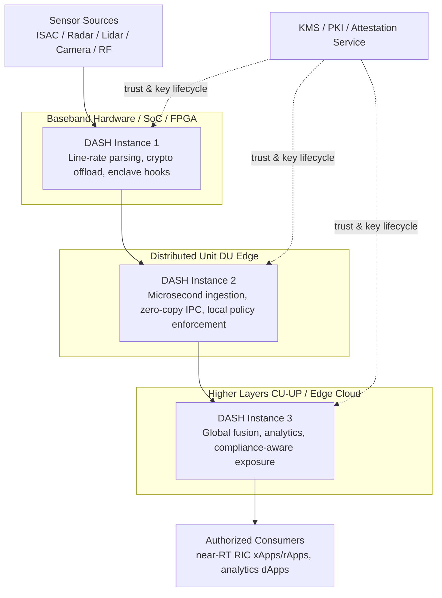
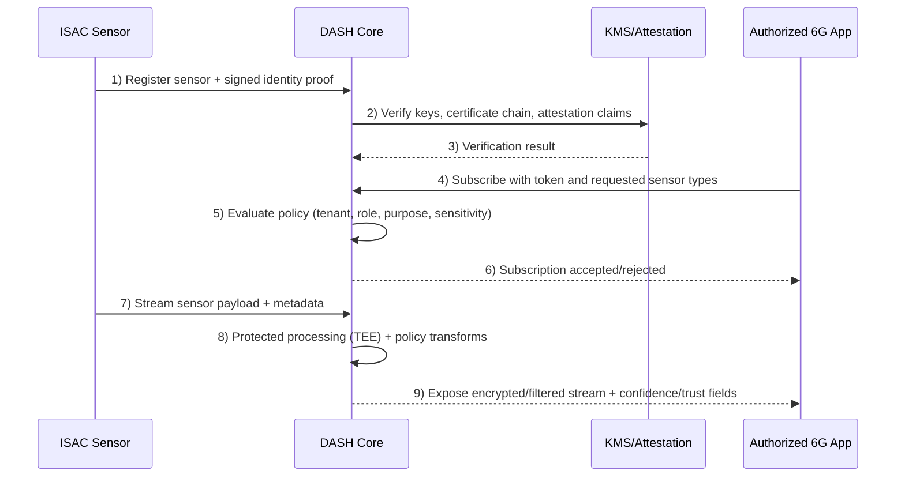

# Data Access and Security Hub (DASH): Technical Design Specification

## 1. Executive Summary

The **Data Access and Security Hub (DASH)** is a proposed 6G RAN data-plane capability that provides:

- **Multi-sensor data aggregation** (ISAC, radar, lidar, camera, RF fingerprinting, and other telemetry)
- **Policy-driven secure data access** for authorized xApps/rApps/dApps
- **Privacy-preserving processing** using TEEs and selective homomorphic techniques
- **Ultra-low-latency exposure paths** for near-real-time RAN intelligence loops

DASH is designed to support **cross-domain innovation goals** aligned with broader 6G initiatives such as multi-technology experimentation, AI-native automation, and trustworthy data sharing across heterogeneous infrastructures.

---

## 2. Design Goals and Non-Goals

### 2.1 Goals

1. **Deterministic, low-latency ingestion and exposure** for time-sensitive RAN sensing/control loops.
2. **Zero-trust security posture** at the data plane boundary.
3. **Deployment flexibility** across hardware, DU edge, and cloud/higher layers.
4. **Interoperable interfaces** via gRPC/Protobuf and policy-based service contracts.
5. **Auditable trust signals** (attestation, lineage, confidence/trust metrics).

### 2.2 Non-Goals

- DASH is **not** a replacement for full OAM/OSS data lakes.
- DASH is **not** a generic long-term archival platform.
- DASH does **not** expose raw sensitive payloads by default; exposure is policy-gated.

---

## 3. System Context and Placement in 6G Architecture

DASH can be instantiated at multiple tiers depending on latency budget, compute capacity, and security/performance requirements.

### 3.1 Corrected Cross-Layer Deployment Diagram (Mermaid)



### 3.2 Deployment Trade-Off Matrix

| Dimension | DU Deployment | Baseband HW / SoC / FPGA | Higher Layers (CU-UP / Edge Cloud) |
|---|---|---|---|
| **Latency target** | 100 µs – 1 ms | < 10 µs (path-dependent) | > 5 ms |
| **Compute profile** | High (x86/ARM) | Constrained but deterministic (ASIC/FPGA/DSP) | Elastic cloud-native |
| **Storage profile** | Ephemeral edge cache | Minimal local buffers | Persistent/object-backed |
| **Best suited for** | Real-time local optimization | Wire-speed preprocessing + crypto primitives | Cross-cell/global analytics |
| **Security anchor** | Host hardening + sandboxing | Hardware root of trust + isolated execution | Zero-trust network segmentation + mTLS |

---

## 4. Functional Architecture

### 4.1 Core Functional Blocks

1. **Sensor Registration & Identity**
   - Device onboarding with cryptographic identity
   - Signature verification and provenance checks

2. **Ingestion & Normalization Pipeline**
   - High-rate stream intake
   - Metadata harmonization across heterogeneous sensors

3. **Policy Decision & Enforcement**
   - Attribute/role-based authorization (RBAC + ABAC-ready)
   - Context-aware release policies per tenant/app

4. **Privacy & Confidential Compute Layer**
   - TEE-backed protected processing domains
   - Selective encrypted-domain operations for allowed analytics

5. **Exposure & Subscription Services**
   - Streaming APIs for approved consumers
   - Trust/confidence metadata in every exposed frame

6. **Telemetry, Audit, and Compliance**
   - Immutable event trails for access and policy outcomes
   - Continuous attestation status monitoring

---

## 5. API Contract (gRPC/Protobuf)

> Notes:
> - In Protobuf v3, enum values are typically non-negative; use `UNSPECIFIED`/`UNKNOWN` as `0`.
> - Trust/confidence values should be numeric for downstream analytics.

```protobuf
syntax = "proto3";

package r6g.dash.v1;

import "google/protobuf/timestamp.proto";

service SensorIngestionService {
  rpc StreamSensorData(stream SensorDataRequest) returns (SensorDataResponse);
}

service SecureExposureService {
  rpc SubscribeSensorData(ExposureSubscriptionRequest) returns (stream ExposedSensorDataPayload);
}

enum SensorType {
  SENSOR_TYPE_UNSPECIFIED = 0;
  SENSOR_TYPE_ISAC_RADAR = 1;
  SENSOR_TYPE_LIDAR = 2;
  SENSOR_TYPE_CAMERA_RGB = 3;
  SENSOR_TYPE_RF_FINGERPRINT = 4;
  SENSOR_TYPE_THERMAL = 5;
  SENSOR_TYPE_PRESSURE_VALVE = 6;
  SENSOR_TYPE_SMART_FAN_TACHOMETER = 7;
  SENSOR_TYPE_UNKNOWN = 8;
}

message SensorDataRequest {
  string sensor_id = 1;
  SensorType type = 2;
  google.protobuf.Timestamp timestamp = 3;
  bytes raw_payload = 4;
  bytes cryptographic_signature = 5;
}

message SensorDataResponse {
  string transaction_id = 1;
  bool status = 2;
  string message = 3;
}

message ExposureSubscriptionRequest {
  string client_id = 1;
  repeated SensorType requested_types = 2;
  string authentication_token = 3;
  bool request_homomorphic_encryption = 4;
}

message ExposedSensorDataPayload {
  string event_id = 1;
  SensorType type = 2;
  google.protobuf.Timestamp processed_timestamp = 3;
  bytes encrypted_data_block = 4;
  double confidence_score = 5;
  string trust_level = 6;
}
```

---

## 6. End-to-End Runtime Sequence



---

## 7. Security, Privacy, and Trust Model

### 7.1 Zero-Trust Data Plane Controls

- Mutual authentication for every producer/consumer path
- Short-lived credentials and continuous re-validation
- Default-deny policy with explicit least-privilege grants

### 7.2 Confidential Compute

- TEE-backed processing isolates sensitive operations
- Host OS/hypervisor visibility into plaintext is minimized by design
- Attestation status can gate exposure eligibility

### 7.3 Cryptography Strategy

- In transit: mTLS for control/data channels
- At rest: policy-bound encryption keys managed by KMS/HSM
- In use: selective encrypted-domain operations where feasible

### 7.4 Differential Privacy for Aggregate Exposure

For aggregate/statistical outputs, calibrated noise can be applied:

\[
M(x) = f(x) + Y
\]

where \(Y\) follows a Laplace or Gaussian mechanism calibrated by sensitivity and privacy budget \((\epsilon, \delta)\).

### 7.5 Trustworthiness Index (Illustrative)

A normalized trust score can be produced per exposure event:

\[
T_i = w_1 S_i + w_2 A_i + w_3 H_i - w_4 R_i
\]

Where:
- \(S_i\): signature validity signal
- \(A_i\): attestation confidence
- \(H_i\): sensor health quality metrics
- \(R_i\): anomaly/risk score
- \(\sum w_k = 1\), \(w_k \ge 0\)

---

## 8. Alignment with 6G Multi-Domain Program Themes

To remain consistent with modern 6G collaborative initiatives (including multi-domain experimentation ecosystems), DASH is designed to support:

1. **Cross-domain interoperability** (RAN + edge/cloud + vertical application layers)
2. **AI-ready data products** with explicit policy and trust metadata
3. **Secure-by-design exposure** for third-party innovation without raw data overexposure
4. **Composable deployment** across heterogeneous compute environments
5. **Experimentation-friendly interfaces** suitable for iterative validation in advanced testbeds

---

## 9. Performance and Reliability Targets (Draft)

- **Ingestion latency (edge path):** p99 < 1 ms (DU deployment profile)
- **Exposure setup latency:** p99 < 50 ms for authenticated subscription
- **Availability objective:** 99.99% for exposure control plane components
- **Backpressure behavior:** bounded queues + deterministic drop policy by priority class
- **Observability:** end-to-end trace IDs for ingestion-to-exposure lineage

---

## 10. Open Items / To-Be-Validated

1. Final sensor taxonomy and extensibility mechanism.
2. Formal policy schema for fine-grained data release conditions.
3. Benchmarked HE scope (exact operations feasible in latency envelope).
4. Hardware profile baselines across FPGA/ASIC/CPU variants.
5. RIC integration profile (E2-compatible exposure adapters).

---

## 11. Revision Notes

- Reorganized the specification into implementation-oriented sections.
- Corrected protocol and mathematical notation issues.
- Replaced ambiguous architecture depiction with coherent deployment/flow diagrams.
- Expanded 6G program alignment content to strengthen external relevance and positioning.
